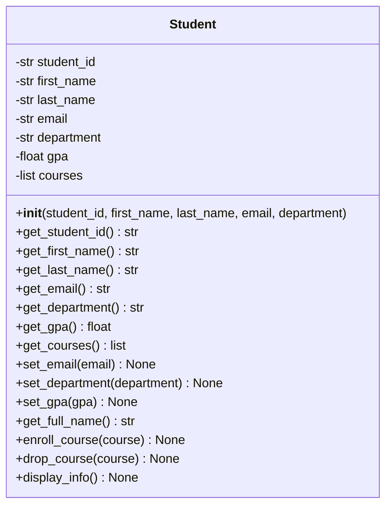

# Student Class Diagram → Python Code

This project maps a simple **Student** UML class diagram to Python code.

## Class Diagram



`-` = private, `+` = public

## Mapping the Design to Code

| UML element | Python code |
|---|---|
| Class box `Student` | `class Student:` |
| Private attributes (`-`) | Attributes with `__` prefix, e.g. `self.__gpa` |
| Public operations (`+`) | Normal methods, e.g. `def get_gpa(self)` |
| Constructor | `__init__` method |
| `courses` list | Python `list` |

Encapsulation: all attributes are private and accessed through getter and setter methods. `set_gpa` checks that the GPA is between 0.0 and 4.0.

## Project Structure

```
student.py   # Student class (from the diagram)
main.py      # Demo program
```

## How to Run

```bash
python main.py
```

## Sample Output

```
Ali Yilmaz enrolled in Object Oriented Programming.
Ali Yilmaz enrolled in Data Structures.
Ali Yilmaz is already enrolled in Data Structures.
Ayse Demir enrolled in Software Design.
Ayse Demir is not enrolled in Calculus.
Invalid GPA! It must be between 0.0 and 4.0.

----- Student Information -----
ID         : 2023001
Name       : Ali Yilmaz
Email      : 2023001@std.neu.edu.tr
Department : Computer Engineering
GPA        : 3.45
Courses    : Object Oriented Programming, Data Structures
-------------------------------
----- Student Information -----
ID         : 2023002
Name       : Ayse Demir
Email      : 2023002@std.neu.edu.tr
Department : Software Engineering
GPA        : 3.8
Courses    : Software Design
-------------------------------
```
